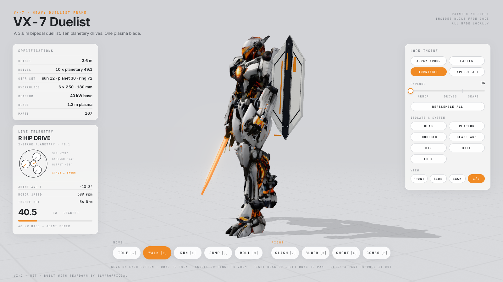
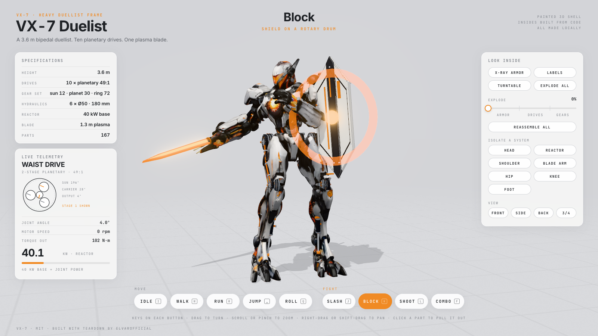
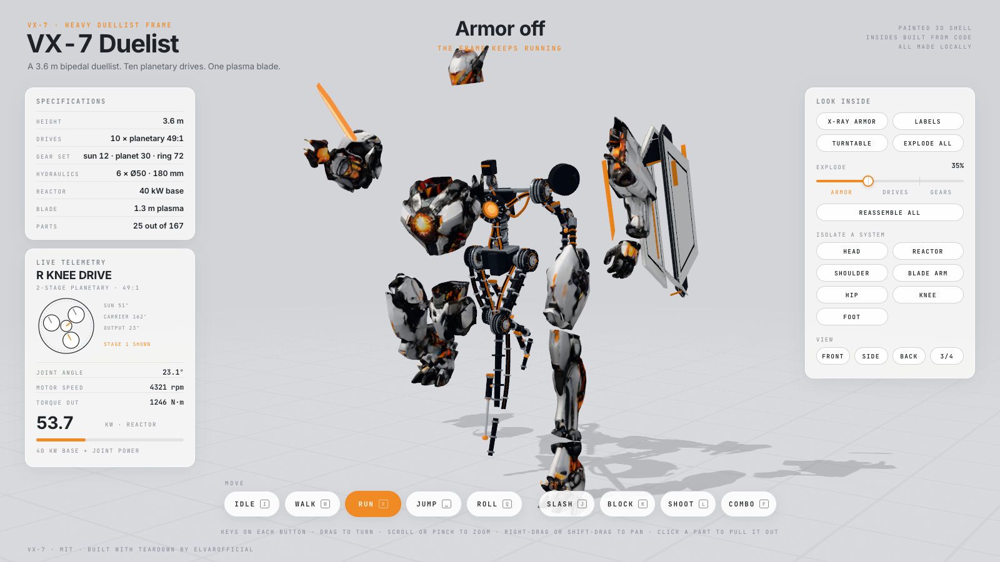

# VX-7 Duelist

A product page for a white fighting mech that you can drive like a game character and take apart: one offline HTML
page. He walks when you arrive; turn, zoom and pan around him while he moves; make him run, jump, roll, slash, block
and shoot; then pull the armor off piece by piece and watch the motors and planetary gears work inside.

**Try it: https://eddiesk-cell.github.io/vx7-teardown/** (a 5.5 MB page; best on a laptop or desktop)







## How it is made

- **Outside: a painted 3D shell made from pictures.** `ref/vx7-reference.png` is the design; `ref/vx7-turnaround.png`
  (front, side, back) and `ref/vx7-exploded.png` were made from it. The front view, with shield and blade cut out
  (`ref/vx7-front-cutout.png`), went through Hunyuan3D-2mini (shape) and Hunyuan3D paint, both run locally with MLX.
  `tools/shell/` holds every step: cut-out, clean-up, joint measurement, web packing (int16 positions, JPEG texture, 3.5 MB).
- **The shell is cut at the joints into 17 armor pieces** (`tools/shell/split.py` writes `vx7-shared/assets/vx7-armor.glb`):
  helmet, chest, pelvis, and per side shoulder, forearm, hand, thigh, shin, ankle and foot. Each joint is cut in the dark
  mechanical gap nearest to it in the paint (the cut slides along the bone to where it crosses the least white armor);
  around the hips, where the pelvis plates overlap the thighs, the line follows the dark gap round those plates (a
  minimum cut). Each piece is one solid piece of surface (stray bits go to the piece around them), cut edges are clipped
  smooth and the normals are shared, so the assembled shell shows no seam. Each piece rides its joint, flies out on
  EXPLODE and pulls out on a click.
- **Inside: built from code** (`vx7-shared/inner.js`, `mech.js`): graphite frame, spine, cables, the chest reactor, knee /
  hock / elbow hydraulics (bore 50, rod 28, stroke 180 mm, rod length from the law of cosines), the shield and the plasma blade.
- **10 planetary drives** (neck, waist, shoulders, elbows, hips, knees): frameless BLDC motor (24 coil slots, 20 magnets,
  encoder disc), two planetary stages (sun 12T, 3 planets 30T, ring 72T, 7:1 each, **49:1** total), cross-roller bearing,
  collar and circlips. 100 toothed gears that mesh and turn from the joint angle.
- **Joints** sit on centres measured on the shell (`REST` in `vx7-shared/kin.js`); every pose, gear angle, torque, rpm and the
  reactor kW readout is a function of `(sequence, tau)` there.

## Controls

- **MOVE:** IDLE `I` · WALK `W` · RUN `R` · JUMP `Space` · ROLL `Q`. **FIGHT:** SLASH `J` · BLOCK `K` · SHOOT `L` (laser
  from the left forearm) · COMBO `F`. Jump, roll and the fight moves play once, then he goes back to the walk, run or idle
  you left him in.
- **Look:** drag to turn, scroll or pinch to zoom, right-drag, shift-drag or two fingers to pan, views `1`-`4`. The camera
  turns slowly on its own until you touch it (TURNTABLE).
- **Look inside:** X-RAY ARMOR `X`, the EXPLODE slider in three stages (ARMOR, DRIVES, GEARS), EXPLODE ALL `E`, ISOLATE
  (head, reactor, shoulder, blade arm, hip, knee, foot), LABELS, click any part to pull it out and again to put it back,
  REASSEMBLE ALL `C`. Live telemetry follows the drive doing the most work in each move.
- The floor is a treadmill: he stays in the middle and the grid rolls back under him at his real speed (1.7 m/s walking,
  6.5 m/s running, 2.8 m per jump, one full turn per roll).

## The film

`vx7-film` is the same page played from a script (`vx7-shared/film.js`) on a fixed clock: walk, run, jump, roll, slash,
block, shoot, a fight in x-ray, running with the armor off, every part out, the right shoulder's gears, back together.
The score (`vx7-shared/score.py`) is synthesised from the same timeline, so every footfall, swing, laser shot and hit lands
on its frame.

```
node tools/timeline.mjs                                   # vx7-film/timeline.json from the script and the moves
python ../teardown/run_sfx.py vx7-shared/score.py         # teardown-out/vx7-score.wav
node ../teardown/sims/build.mjs ./vx7-film
node ../teardown/sims/capture.mjs vx7-film --size 1600x900 --dpr 1.2 --out teardown-out/vx7-silent.mp4
ffmpeg -i teardown-out/vx7-silent.mp4 -i teardown-out/vx7-score.wav -map 0:v -map 1:a -c:v copy -c:a aac -shortest teardown-out/vx7-film.mp4
```

## Build

The page is bundled with the [teardown](https://github.com/elvarofficial/teardown) kit. Clone it next to this repo:

```
git clone https://github.com/elvarofficial/teardown ../teardown
(cd ../teardown && npm install)
node ../teardown/sims/build.mjs ./vx7-live        # -> teardown-out/dist/vx7-live.html (about 5.5 MB, works from file://)
```

`docs/index.html` is a copy of that build.

Checks (need Playwright's Chromium, or point `CHROMIUM` at any Chrome):

```
CHROMIUM=/path/to/chrome node tools/product-check.mjs  # clicks the buttons and keys, pans, zooms, pulls a part; exit 1 on a fail
CHROMIUM=/path/to/chrome node tools/moves.mjs          # review/moves-*.png: every move at its key moments
CHROMIUM=/path/to/chrome node tools/shoot.mjs          # review/01..12 .png: x-ray, explode, isolates, labels
```

Test hooks live on `window.LIVE`: `setExplode(k)`, `setDisplay(key, on)`, `isolate(name|null)`, `pull(partId)`, `reassemble()`,
`setSeq(name, tau)`, `press(buttonKey)`, `setView(name)`, `pan(x, y, zoom)`, `parts`, `gearCount()`, `homeError()`.

## Credits and license

Code: MIT. Built with [elvarofficial/teardown](https://github.com/elvarofficial/teardown) (MIT), whose kit is from
[whaleyxbt/claude-motion](https://github.com/whaleyxbt/claude-motion) (MIT). The shell was generated with Tencent
Hunyuan3D-2 models (Tencent Hunyuan Community License, which does not cover the EU, the UK or South Korea).
