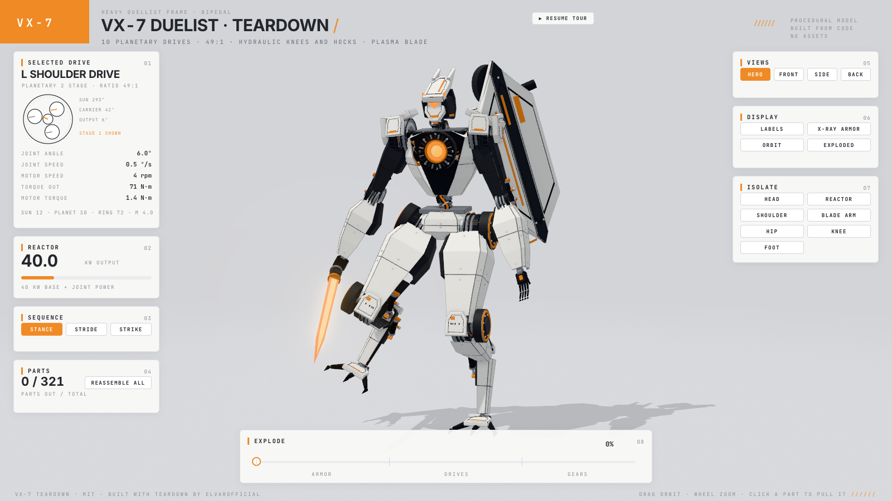
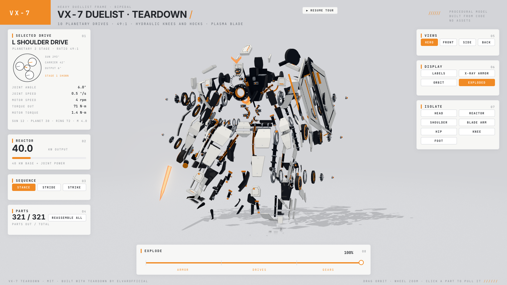

# VX-7 Duelist · teardown

A take-apart 3D simulator of a white fighting mech, drawn entirely from code: one offline HTML page, no model files.
Spin it, pull the armor off, slide every joint's motor and planetary gearbox out and watch the gears turn.





## What is in it

-   actuators, 6 reactor parts. Click any panel or drive to pull it out along its explode vector; click again to put it back.
- **10 planetary drives** (neck, waist, both shoulders, elbows, hips, knees). Each is a frameless BLDC motor (24 coil slots,
  20 magnets, encoder disc), two planetary stages (sun 12T, 3 planets 30T, ring 72T, module 4 mm, 7:1 each, **49:1** total),
  a cross-roller bearing with balls, collar and circlips. 100 toothed gears that mesh and turn from the joint angle.
- **Hydraulics**: knee, hock and arm pistons (bore 50, rod 28, stroke 180 mm); rod length is the law of cosines on the mount points.
- **EXPLODE** slider in three stages: ARMOR, DRIVES, GEARS. **X-RAY ARMOR**, **ISOLATE** (head, reactor, shoulder, blade arm, hip,
  knee, foot), **LABELS** with leaders, four views, orbit, and an auto tour that hands control to you on any input.
- Three sequences, STANCE, STRIDE, STRIKE. Every pose, gear angle, torque, rpm and the reactor kW readout is a function of
  `(sequence, tau)` in `vx7-shared/kin.js` (no three.js there). `shoot.mjs` also writes `review/compare.png` (reference | render) and `compare-mask.png`, and prints the silhouette IoU.

## Build

The page is bundled with the [teardown](https://github.com/elvarofficial/teardown) kit. Clone it next to this repo:

```
git clone https://github.com/elvarofficial/teardown ../teardown
(cd ../teardown && npm install)
node ../teardown/sims/build.mjs ./vx7-live        # -> teardown-out/dist/vx7-live.html (about 0.8 MB, works from file://)
```

`docs/index.html` is a copy of that build for GitHub Pages.

Review stills (needs Playwright's Chromium, or point `CHROMIUM` at any Chrome):

```
CHROMIUM=/path/to/chrome node tools/shoot.mjs      # review/01..12 .png, exits 1 on any console error
CHROMIUM=/path/to/chrome node tools/tour-check.mjs # runs the auto tour once and prints fps
CHROMIUM=/path/to/chrome node tools/fit.mjs        # hill-climbs the stance angles against the reference silhouette
```

Test hooks live on `window.LIVE`: `setExplode(k)`, `setDisplay(key, on)`, `isolate(name|null)`, `pull(partId)`, `reassemble()`,
`setSeq(name, tau)`, `setView(name)`, `takeOver()`, `parts`, `gearCount()`, `homeError()`.

## Layout

```
vx7-shared/  kin.js (numbers)  mech.js + body.js (geometry)  stage.js  console.js  tour.js  live.js
vx7-live/main.js
tools/       shoot.mjs  tour-check.mjs
ref/         the reference picture the model was matched against
```

## Credits and license

MIT. Built with [elvarofficial/teardown](https://github.com/elvarofficial/teardown) (MIT), whose kit is from
[whaleyxbt/claude-motion](https://github.com/whaleyxbt/claude-motion) (MIT).
